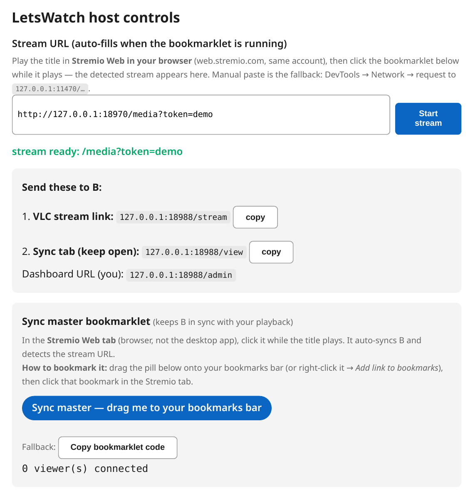

# LetsWatch

Watch something together: the host plays it, and a friend's VLC (or browser) follows
play/pause/seek in near real time. The friend installs nothing.

LetsWatch sits between a local **Stremio** engine and the viewer:

```
Host browser (web.stremio.com)
        │  bookmarklet: play / pause / seek / current stream URL
        ▼
   LetsWatch server  ──WebSocket──▶  viewer page (sync + status)
        │                                  │
        │  /stream proxy                   └──▶  VLC HTTP interface
        ▼
   Stremio engine (127.0.0.1:11470)
```

The host shares two links: a `/stream` URL for VLC and a `/view` page that stays open and
keeps the viewer in sync.



*The host controls: start a stream, copy the two viewer links, and generate the sync
bookmarklet.*

> **Status:** personal-use tool, not a production streaming service. Read the
> [security model](#security-model) before exposing it through a tunnel.

## Requirements

- **Node.js 18+** and npm.
- **Stremio** with its local streaming engine on `127.0.0.1:11470`. On Linux the Flatpak
  `com.stremio.Stremio` is the usual choice.
- **VLC** for the VLC viewing mode, with its Web interface enabled (see below). The
  browser mode needs no VLC.
- Optional: **cloudflared** for a public tunnel when the viewer is not on your LAN.

## Quick start

```bash
git clone https://github.com/georgian3768/letswatch.git
cd letswatch
npm ci
```

Start the Stremio engine and leave it running:

```bash
flatpak run com.stremio.Stremio
```

In another terminal, start LetsWatch:

```bash
npm start
```

The server prints an **admin key**. Open <http://127.0.0.1:8787/admin>, paste the key and
save it. To share outside your network, start a tunnel in a third terminal:

```bash
npm run tunnel
```

`tunnel.sh` prints the public `/stream`, `/view` and `/admin` URLs. Keep it running for the
whole session; the URL changes every time you restart it.

If `cloudflared` is missing, install the build for your platform from the
[official releases](https://github.com/cloudflare/cloudflared/releases). On Linux x86-64:

```bash
mkdir -p ~/.local/bin
curl -L -o ~/.local/bin/cloudflared \
  https://github.com/cloudflare/cloudflared/releases/latest/download/cloudflared-linux-amd64
chmod +x ~/.local/bin/cloudflared
```

### Host workflow

1. Open <https://web.stremio.com> in your browser (same Stremio account) and start the
   title. The desktop app only supplies the local engine.
2. On the **tunnel's** `/admin` page, drag the **Sync master** bookmarklet to your bookmarks
   bar (or right-click → *Add link to bookmarks*). Use the tunnel URL rather than
   `localhost`: `web.stremio.com` is HTTPS, and a `ws://localhost` bookmarklet would be
   blocked as mixed content. The tunnel page generates a `wss://` bookmarklet.
3. Click that bookmark **in the Stremio tab** while the title is playing. It reports
   playback state and the current stream path.
4. Back on `/admin`, the detected stream appears — click **Use this stream**. You can also
   paste a `127.0.0.1:11470/...` path manually.
5. Send the viewer the **`/stream`** link (for VLC) and the **`/view`** link (sync page).

### Viewer workflow

1. VLC → *Media* → *Open Network Stream* → paste the `/stream` URL → Play.
2. Open the `/view` link in a browser and keep the tab open.
3. The host's play/pause/seek actions drive VLC.

If VLC control is not working, use **Watch in browser** on the `/view` page — the video
plays inline and stays synced, with no VLC configuration.

### VLC Web interface (VLC mode only)

VLC → *Tools* → *Preferences* → *Show All* → *Interface* → *Main interfaces* → tick
**Web** → save and restart VLC. Leave it bound to localhost; do **not** expose VLC's port
(usually 8080) to the internet.

The viewer page defaults to `http://localhost:8080` and `/requests/status.xml`. These can
be overridden in the browser via localStorage:

```js
localStorage.setItem('lw.vlc.host', 'http://localhost:8080');
localStorage.setItem('lw.vlc.path', '/requests/status.xml');
localStorage.setItem('lw.vlc.seek', 's'); // or 'ms'
```

## Configuration

Environment variables:

| Variable | Default | Purpose |
|---|---|---|
| `PORT` | `8787` | HTTP port |
| `HOST` | `127.0.0.1` | Bind address. Keep localhost unless you really need LAN access |
| `ENGINE` | `http://127.0.0.1:11470` | Stremio engine base URL |
| `ADMIN_KEY` | random per start | Fixed admin key; useful when you want a stable bookmarklet |
| `CLOUDFLARED` | `cloudflared` | Path to the cloudflared binary |

Example:

```bash
ADMIN_KEY="$(openssl rand -hex 16)" PORT=8787 npm start
# then use the same value on /admin
```

Browser localStorage keys: `lw.adminKey`, `lw.player`, `lw.vlc.host`, `lw.vlc.path`,
`lw.vlc.seek`.

`tunnel.sh` also honors `PORT` and `CLOUDFLARED`; set the same `PORT` you used for the
server.

## Security model

LetsWatch is designed for **one host and one trusted viewer**, not for public hosting.

- The tunnel URL is effectively an access token. Anyone who has it can open `/view`, watch
  `/stream`, and see the host's playback state. Only share it with the person you are
  watching with, and stop the tunnel when you are done.
- `/api/session` requires the admin key. The WebSocket **master** role also requires the
  key; the key is embedded in the bookmarklet you generate on `/admin`. Do not share that
  bookmarklet.
- Viewer connections and `/stream` are **not authenticated**. The stream URL is meant to
  be given to the viewer.
- The admin key is printed in the server terminal. If you use a tunnel, keep the terminal
  and the `/admin` link private.
- VLC's Web interface has no authentication. Bind it to localhost and never port-forward
  it. Anyone who can reach it can control your VLC.
- The default bind address is `127.0.0.1`. Setting `HOST=0.0.0.0` exposes the server to
  your LAN; only do that on a network you trust.
- Do not use this to bypass DRM or to stream content you do not have the right to share.

If you need a hardened multi-user deployment, put LetsWatch behind a real reverse proxy
with authentication, TLS and per-viewer tokens; the current single-session model is not
built for that.

## Limitations

- One global stream session and one master. Starting a new stream replaces the old one for
  every viewer.
- The tunnel URL is ephemeral and changes on every restart.
- Stremio engine behaviour is version-dependent; this project targets the local engine on
  port `11470`.
- Streams that require extra request headers (some TorBox/yastream rows) may need a custom
  header profile in `lib/proxy.js`; the default proxy only forwards the viewer's headers.
- Browser playback depends on the codecs the viewer's browser supports. VLC is the more
  reliable option for unusual formats.
- No recording, no multi-room audio, no DRM handling.

## Troubleshooting

| Symptom | Check |
|---|---|
| `LetsWatch is not running` from `tunnel.sh` | Start `npm start` first and confirm the port matches `PORT` |
| `engine unreachable` on `/stream` | Stremio is running and `curl http://127.0.0.1:11470` responds |
| `/admin` says unauthorized | Re-enter the key printed by the server; it changes on restart unless `ADMIN_KEY` is set |
| Bookmarklet does nothing | Drag it again after saving the key; it embeds the current admin key |
| VLC does not follow | Enable VLC's Web interface, restart VLC, and check `lw.vlc.host` |
| Viewer page shows “connecting…” | The tunnel or server stopped; restart both and resend the new URL |
| Video does not play in browser | Try VLC mode; the browser may not support the codec |

## Development

```bash
npm ci
npm test
```

The smoke test starts the server on `127.0.0.1:18987` with a fixed test key, checks the
pages and admin API, and verifies that an unauthenticated WebSocket master is rejected.

GitHub Actions runs the same test on Node 20 and 22.

## License

MIT — see [LICENSE](LICENSE).